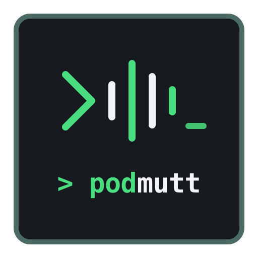
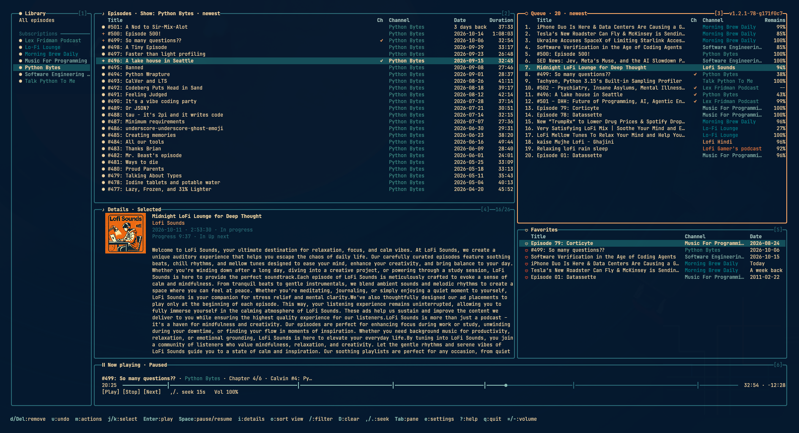
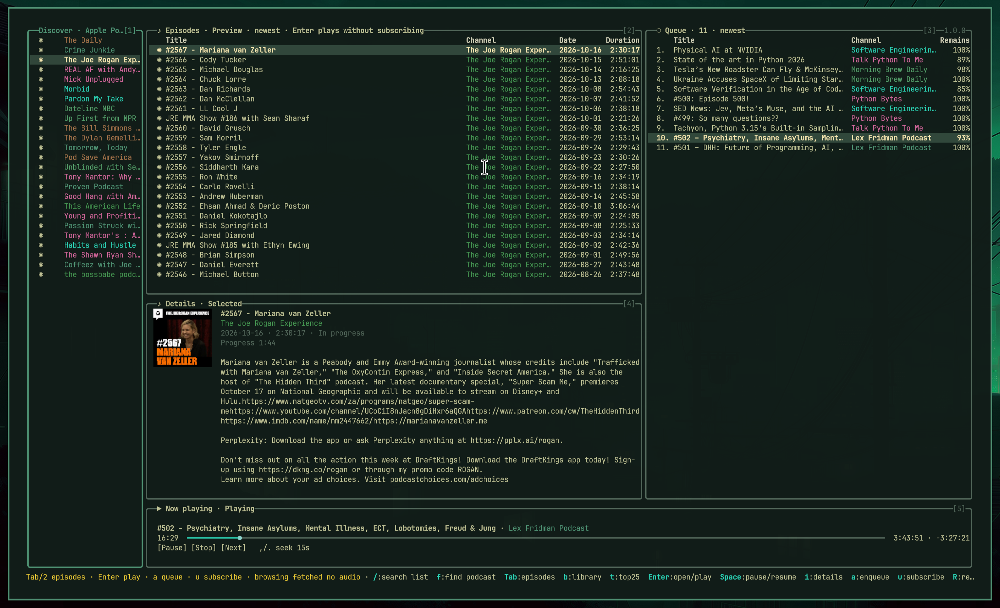
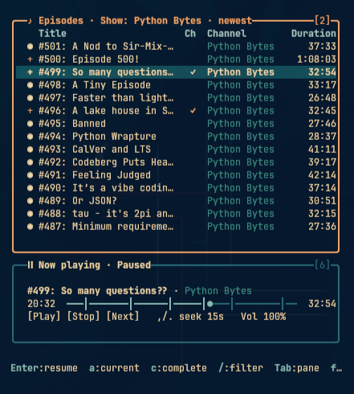

<p align="center">
  
</p>

# podmutt

A modern, keyboard-driven podcast client (TUI) for Linux and macOS inspired by lazygit and mpdtui. Built with Go, Bubble Tea, SQLite, and mpv.

[](https://github.com/susamn/podmutt/releases)
[](https://go.dev)
[](LICENSE)

---

Bordered panels, single-key contextual actions, vim navigation, and live audio streaming through mpv — no mouse required.

## Screenshots

### Dashboard
Full 5-pane layout featuring Library, Episodes, Up next queue, Details card, and Now playing HUD.



### Discover & Preview
Directory browsing (Apple Top 100 / search) with customer star ratings and read-only episode previews without subscribing.



### Compact Mode
Responsive layout adapting automatically when terminal dimensions shrink.



---

## Features

- **Local-First & Offline**: Instant cached library browsing; feeds refresh periodically in the background without blocking the UI.
- **Top Charts & Global Discovery**: Browse Apple Podcasts Top 100 charts (auto-localized to your country, e.g. US, Germany, UK, France) with customer star ratings.
- **Stream Without Subscribing**: Preview show notes and stream/enqueue episodes directly from RSS without polluting your subscription catalog.
- **Fixed Player HUD**: Real-time progress bar, responsive layout, and dedicated ±15-second seeking hotkeys (`,`/`.`).
- **Shared Activity Status**: A fixed row above key hints shows ongoing searches, previews, feed refresh counts, artwork/ratings loads, and other finite background work without blocking navigation.
- **Queue Management**: Remove the selected Queue episode (`d`) after confirmation, including current audio, with single-step session undo (`u`). Progress and history are preserved.
- **Podcast Artwork**: Crisp cover art via Kitty graphics protocol with automatic image-derived ASCII fallback.
- **Live Theming**: Color presets (Catppuccin, Solarized Dark, Cyberpunk) with live `SIGUSR1` reloading.
- **Desktop Media Integration**: Native MPRIS D-Bus support on Linux for desktop media keys.

---

## Install

### Homebrew (macOS and Linux)

```sh
brew tap susamn/tap
brew install --cask podmutt
```

> **macOS First Run Note**: Because `podmutt` is an open-source terminal application not signed with an Apple Developer ID, macOS Gatekeeper may show a one-time verification warning on first run (*"Apple could not verify..."*). Run this command once in your terminal to allow it:
> ```sh
> xattr -d com.apple.quarantine $(which podmutt)
> ```
> *(Or click **Open Anyway** in **System Settings > Privacy & Security**).*

Runtime playback streams audio through `mpv`:
- macOS: `brew install mpv`
- Ubuntu/Debian: `sudo apt install mpv`
- Arch Linux: `sudo pacman -S mpv`
- Fedora: `sudo dnf install mpv`

### Pre-built Binaries

Download pre-compiled standalone archives for Linux and macOS (`amd64` and `arm64`) from [GitHub Releases](https://github.com/susamn/podmutt/releases).

### Build from Source

Requires Go 1.27+ and Make:

```sh
git clone https://github.com/susamn/podmutt.git
cd podmutt
make build        # bin/podmutt
```

---

## Getting Started

### 1. Launching
Start the application from your terminal:
```sh
podmutt
```
On first run, a Quick Start overlay appears with essential hotkeys. Press **Enter** or **Esc** to begin.

### 2. Discovering & Browsing Shows
- Press **`b`** to switch between **My Library** and **Discover** (Apple Top 100).
- Use **`j` / `k`** (or `↑` / `↓`) to scroll through the Top 100 podcasts in your region.
- Press **`Enter`** on any show to fetch its RSS feed and preview its episodes.
- Press **`i`** to inspect the podcast's description and customer star ratings in **Details (4)**.
- Press **`u`** to subscribe to the podcast and save it into your permanent Library.

### 3. Searching for Podcasts or RSS Feeds
- Press **`f`** from anywhere:
  - **By Name**: Type any podcast title (e.g. `The Daily`, `Zeit Verbrechen`) and press **Enter** to search.
  - **By URL**: Paste any direct RSS/Atom feed or podcast website URL (e.g. `https://feeds.simplecast.com/...`).
- Press **Tab** in the search dialog to choose **Library**, **Apple Podcasts**, or **Podcast Index**. Library searches saved subscriptions and episode text offline; online providers search show names. Podcast Index requires your own credentials; see [setup](docs/podcast-index.md).

### Importing subscriptions from OPML
Export your subscriptions from another podcast app as an `.opml` file, then close podmutt and run:
```sh
podmutt import-opml subscriptions.opml
```
Every feed is fetched and subscribed (nested folders are flattened, duplicates are skipped, and shows you already follow are left untouched). Failing feeds are listed and the exit code is non-zero, but the rest are still imported. The command takes the same profile lock as the UI, so it cannot run while podmutt is open.

### 4. Playing & Queuing Episodes
- Move to the **Episodes (2)** list with **`Tab`** or press **`2`**.
- Press **`Enter`** on any episode to stream it instantly.
- **`Space`** pauses/resumes current audio from **any** panel.
- **`,`** and **`.`** seek backward and forward **15 seconds**.
- **`C`** opens chapters for the **currently playing** episode (not the highlighted row). Use **`j`/`k`**, arrows, or Page Up/Down; **Enter** jumps and **Esc** cancels. Seeking keeps the paused/playing state. The separate **Ch** column in Episodes and Queue shows a right-aligned, accent-colored `✓` (including plain mode) for advertised or cached chapters; its width comes from Title. Details shows the count when known. Linked Podcasting 2.0 JSON is fetched and cached once during feed refresh (unless its URL changes), not when you press `C`. Inline Podlove chapters are cached from the feed. Embedded chapters can only be inspected after the audio loads; mpv checks and caches them then, without downloading other episodes' audio. Pressing `C` only reads cached chapter information.
- Press **`a`** to add an episode to your **Up next (3)** queue.
- In **Queue (3)**, press **`d`** or **Delete** on an episode, then **`y`** to remove it or **`n` / Esc** to cancel. Removing current audio stops it without starting another episode; progress/history are kept. **`u`** restores the last removal as pending, without autoplay.

### 5. Switching Panels & Horizontal Panning
- **`Tab`** cycles forward through the main lists: **Podcasts (1) → Episodes (2) → Queue (3) → Favorites (5)**.
- **`Shift+Tab`** cycles backward.
- **`1`**, **`2`**, **`3`**, **`4`**, **`5`**, **`6`** jump directly to any panel (`1` Podcasts, `2` Episodes, `3` Queue, `4` Details, `5` Favorites, `6` Player).
- **`h` / `l`** (or `←` / `→`) scroll wide titles horizontally on compact screens.

### 6. Personalizing
- Press **`e`** to open Settings:
  - Use **`j` / `k`** to pick a theme (*Catppuccin*, *Solarized Dark*, *Cyberpunk*) and press **Enter** to apply.
  - Use **`Left` / `Right`** to cycle your discovery storefront country (`US`, `DE`, `GB`, `FR`, `CA`, `JP`, etc.).
- Press **`?`** anytime for the full keybinding cheat sheet.

---

## Keybindings (Vim-Style)

### Navigation

| Key | Action |
| :--- | :--- |
| `Tab` / `Shift+Tab` | Cycle main lists (**Podcasts → Episodes → Queue → Favorites**) |
| `1`–`6` | Directly focus pane (`1` Podcasts, `2` Episodes, `3` Queue, `4` Details, `5` Favorites, `6` Player) |
| `j` / `k` or `↑` / `↓` | Move selection up / down |
| `h` / `l` or `←` / `→` | Scroll content horizontally on narrow screens |
| `g` / `G` | Jump to first / last item |
| `Ctrl+d` / `Ctrl+u` | Scroll half-page down / up |
| `Esc` | Clear filter / return back from Details |

### Playback & Transport

| Key | Action |
| :--- | :--- |
| `Enter` | Open show / Play selected episode |
| `Space` | Pause / Resume current playback from any pane |
| `s` | Stop current playback |
| `n` | Skip to next episode in queue |
| `,` / `.` | Seek backward / forward 15 seconds |
| `C` | Open cached chapters for current playback (`j`/`k`/arrows/Page Up/Page Down, Enter jump, Esc cancel) |

### Library & Queue

| Key | Action |
| :--- | :--- |
| `a` | Enqueue selected episode to Up Next |
| `A` | Enqueue all visible episodes in current list |
| `m` | Open episode actions menu in Queue (Mark as favorite) |
| `d` / `Delete` | Confirm removal of selected Queue episode (stops if current) or un-favorite in Favorites |
| `u` | Undo last removal (in Queue) / Toggle subscription (in Podcasts) |
| `D` | Clear all pending queue items (with confirmation) |
| `o` | Cycle sorting (newest, oldest, title) |
| `c` | Toggle episode completed mark |
| `R` | Manually refresh feeds or directory |

### Discovery & Search

| Key | Action |
| :--- | :--- |
| `b` | Toggle between **My Library** and **Discover** (Top 100) |
| `f` | Find podcasts by name or paste an RSS/website URL |
| `U` | Open direct RSS/website preview dialog |
| `t` | Jump to Top 100 chart in Discover |
| `N` | Add podcast feed URL directly |
| `/` | Filter current list |

### System & Settings

| Key | Action |
| :--- | :--- |
| `e` | Settings (Theme picker, Country switcher) |
| `?` | Open keybinding cheat sheet |
| `!` | Read the full error/warning; `j` / `k` scroll, `Esc` dismisses |
| `q` / `Ctrl+C` | Quit |

---

## Status and recovery

The fixed row above key hints shows ongoing work and actionable failures, including
on small terminals. Background refreshes do not replace a failed user action.
Press **`!`** to read the full error or feed-refresh warning, **`j` / `k`** to scroll,
and **Esc** to dismiss. Close text input or another dialog first; its keys still
belong to that input/dialog. **`R`** retries the active Discover search/chart or feed
preview; in Library it refreshes subscribed feeds. Failed refreshes do not prevent
browsing already saved metadata. Media warnings expose the same full details
through their **`Media (!)`** label. The maintained developer inventory is in
[User-facing messages](docs/user-messages.md).

If an older binary reports that the database was upgraded by a newer podmutt,
upgrade the executable or run the newer binary used previously. **Do not delete
the database, edit its schema version, or run podmutt as root.** Other database
failures need their own diagnosis; upgrading is not a universal database fix.

## Configuration

The configuration file is located at:
- **Linux**: `~/.config/podmutt/config.toml`
- **macOS**: `~/Library/Application Support/podmutt/config.toml`

An absent file uses these defaults:

```toml
refresh_minutes = 30
mpv_path = "mpv"
country = "us"             # Auto-detected from system locale (e.g. "de", "gb", "fr")
theme = "colors"           # "colors", "solarized-dark", "catppuccin", etc.
icons = "unicode"          # "unicode" (default), "nerd" (Nerd Font), or "plain"
player_decoration = false  # Optional hairline visualizer in spacious layouts
```

---

## Running-Instance CLI Commands

`podmutt` supports CLI commands that contact the running instance over a private UNIX socket:

```sh
podmutt play
podmutt pause
podmutt stop
podmutt next
podmutt status   # outputs JSON status of running instance
```

---

## Development

```sh
make check       # formatting, module consistency, vet, tests, >=95% coverage
make race        # native race-detector tests
make mpv-test    # real-mpv lifecycle/playback tests, null audio (requires mpv)
make mpris-test  # private D-Bus protocol tests (requires dbus-daemon)
make build       # build bin/podmutt
make dist        # cross-build Linux/macOS archives in dist/
```

---

## License

Licensed under the [MIT License](LICENSE).
